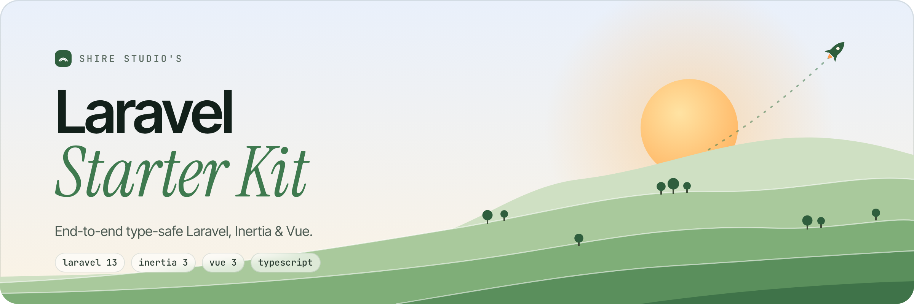

<picture>
    <source media="(prefers-color-scheme: dark)" srcset="art/header-dark.png">
    
</picture>

<br/>
<br/>

<p>
    <a href="https://github.com/shire-studio/laravel-starter-kit-livewire/actions"></a>
    <a href="https://packagist.org/packages/shire-studio/laravel-starter-kit-livewire"></a>
    <a href="LICENSE.md"></a>
</p>

A strict, fully tested Laravel 13 starter kit with Livewire 4 and Flux. It shares its actions, form requests, models and controllers with the Shire Studio Inertia kits, so the same application logic sits behind Blade views instead of a JavaScript frontend.

## Tech Stack

**Backend:** PHP 8.5+, Laravel 13, Livewire 4, Laravel Fortify, Nuno Maduro's Essentials

**Frontend:** Flux, Alpine (bundled with Livewire), TypeScript, Tailwind CSS v4

**Code quality:** PHPStan (level max via Larastan), Rector, Pint (PHP and Blade), oxlint, oxfmt, Pest v5 (100% coverage)

## Features

- **Shared application layer:** the same actions, form requests and controllers as the Vue, React and Svelte kits
- **Class based Livewire components:** interactive settings live in `app/Livewire`, so PHPStan, type coverage and code coverage apply to them
- **Dark mode and appearance switching:** powered by Flux
- **Complete authentication:** login, registration, password reset, email verification, two factor authentication and passkeys via Laravel Fortify
- **Toasts after redirects:** controllers flash a `toast` and the layout shows it with Flux
- **Preloaded assets:** critical CSS and JS are preloaded through Link headers

## Local Development

> **Requires [PHP 8.5+](https://php.net/releases/), [Node 22+](https://nodejs.org/), [pnpm](https://pnpm.io/) and a code coverage driver such as [Xdebug](https://xdebug.org/docs/install).**
>
> SQLite is used by default for the database, sessions, cache and queue.

```bash
composer create-project shire-studio/laravel-starter-kit-livewire --prefer-dist example-app
cd example-app

# Install dependencies, create .env, generate a key, migrate and build assets
composer setup

# Start the server, queue worker, logs and Vite
composer dev
```

## Available Commands

- `composer dev` starts the app with Laravel's `artisan dev` process runner
- `composer lint` runs Rector, Pint (PHP and Blade) and Vite Plus and fixes what it can
- `composer test:lint` checks formatting and linting without changing files
- `composer test:types` runs PHPStan and the TypeScript type check
- `composer test:type-coverage` enforces 100% type coverage
- `composer test:unit` runs Pest with the 100% code coverage requirement
- `composer test` runs all of the above
- `composer update:requirements` bumps every PHP dependency to its latest version

## Code Standards

- **Actions oriented architecture:** every operation lives in a single action class under `app/Actions`
- **Cruddy by design:** controllers stick to resourceful methods
- **Immutable first:** data structures favour immutability to prevent unexpected mutations
- **Fail fast:** strict static analysis catches errors before runtime
- **Strict Laravel defaults:** strict models, automatic eager loading and immutable dates via [Essentials](https://github.com/nunomaduro/essentials)
- **AI guidelines:** the rules in `.ai/rules` keep generated code consistent with the rest of the codebase

## Testing

The project uses [Pest](https://pestphp.com) and enforces:

- **100% code coverage:** the suite fails if coverage drops below 100%
- **100% type coverage:** every method, property and parameter is explicitly typed
- **Static analysis:** PHPStan at level max

Run the full suite with:

```bash
composer test
```

## Releasing

Releases are published by the **release** workflow, not from the Releases page. In the Actions tab, run it on `main` with the new version, for example `v1.5.0`.

The workflow writes the version to `.starter-kit.json`, commits it on top of `main`, tags that commit and publishes a GitHub release with generated notes. Every project created from the release then knows which version it started from, which the [starter kit CLI](https://github.com/shire-studio/laravel-starter-kit-cli) uses to update it later. The release commit is only reachable from its tag, so `main` itself never has a `.starter-kit.json`.

## Contributing

This repository is raised by [Hobbiton](https://github.com/shire-studio/hobbiton), which grows every Shire Studio starter kit from shared smials. Please open issues and pull requests there, so a fix reaches every kit.

## License

This project was created by **Shire Studio** under the **[MIT license](LICENSE.md)**.
